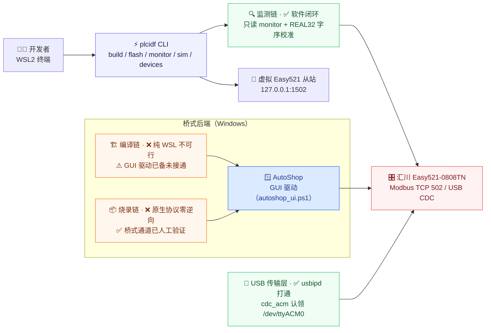

# ⚡ PLC-IDF

[](https://www.python.org/)
[](https://learn.microsoft.com/windows/wsl/about)
[](https://www.modbus.org/)
[](https://www.inovance.com/)
[](wsl-tools/tests/)
[](https://polyformproject.org/licenses/noncommercial/1.0.0)

> **PLC-IDF** 是对标 ESP-IDF 的汇川 PLC 开源工具链：在 Linux/WSL 里以一条 `plcidf` 命令完成汇川 Easy521 的「编译 → 烧录 → 监测」，把 PLC 开发做成 ESP-IDF 风格的命令行体验。

---

## 🌟 项目简介

**PLC-IDF** 把汇川 Easy521 PLC 开发做成 **ESP-IDF 风格的 WSL CLI 体验**：一条命令 `plcidf build / flash / monitor` 完成「编译 → 烧录 → 监测」。桥式后端先用（Windows 作为不可见编译服务器，驱动 AutoShop），协议逐条逆向后再替换为原生后端。目标设备：汇川 Inovance **Easy521-0808TN**（固件 6.11.0.1，AutoShop V4.11.0.5），约束为 **USB Type-C 单线**（网口待拓展坞）。

- 🏷️ **曾用名**：项目曾用名 **py2plc**，已更名 **PLC-IDF**（包名 `plc_idf`，命令名 `plcidf`）；`py2plc` 命令保留为等价别名。历史档案（`docs/wsl-feasibility/`、`wsl-probe/`、`wsl-tools/` 等）沿用原名，保留原貌。
- ⚙️ **CLI 状态**：`plcidf build / flash / monitor / sim / devices` 五个子命令已可用（`monitor` / `sim` / `devices` 真实可用；`build` / `flash` 默认 dry-run，真执行需双因子授权，桥式 GUI 驱动链待 P2 演练接通）。安装：仓库根 `pip install -e .`。

---

## 🖼️ 架构与能力链总览



---

## 📊 项目状态板

| 能力链 | 当前状态 | 路线 |
| :--- | :--- | :--- |
| **监测链** | ✅ 软件闭环可用：虚拟从站 + 只读 monitor + 字序校准（65 测试全过，2026-10-16 复验）；❌ USB 编程口 RTU 已证伪（15 组合零应答，证据 `wsl-probe/usb-rtu/`）；⏳ 真机网口未接（无网口硬件） | **P4** 拓展坞到位后走网口 Modbus TCP（502 端口，首连必 `--calibrate`）；**P3** USB 抓包评估是否立项原生 USB 监测 |
| **编译链** | ❌ 纯 WSL 不可行：AutoShop 无 CLI/无头接口，Wine 零成功记录；⚠️ 桥式 GUI 驱动工具已备未接通（`plc/tools/autoshop_ui.ps1`） | **P2** AutoShop GUI 桥接演练（需用户在场）；中期观察 autoshop-mcp 无头编译路线（H3U 已证 DLL 可行，H5U 需适配） |
| **烧录链** | ❌ 原生私有协议全网零文档零逆向；✅ 桥式通道已人工验证：AutoShop USB 下载在真机走通（证据 `plc/easy521/evidence/`） | **P2** 用户授权后做 detach→AutoShop 下载→attach 全流程演练；原生下载器视 P3 抓包结论决定是否立项 |
| **USB 传输层** | ✅ usbipd 挂载打通，内核 cdc_acm 认领 `/dev/ttyACM0`（2026-10-16 实测） | 维持 usbipd attach/detach 工作流（与 AutoShop 使用互斥） |

路线图全景（P1 侦察 ✅ → P2 GUI 桥接 → P3 协议抓包 → P4 网口直连）见 [docs/wsl-feasibility/00-synthesis-and-roadmap.md](docs/wsl-feasibility/00-synthesis-and-roadmap.md)。

---

## 🚀 快速上手

### 环境要求

- Windows 10/11 + **WSL2**（Ubuntu）；对真机做 USB attach 时需要 **usbipd-win**（当前监测演示不需要 USB）。
- Python 3.12 虚拟环境（仓库根 `.venv/`）：`pymodbus 3.16.1`、`pyserial`、`pytest`。

```bash
python3.12 -m venv .venv
.venv/bin/pip install pymodbus pyserial pytest
.venv/bin/pip install -e .        # 安装 PLC-IDF CLI（plcidf 命令 + py2plc 别名）
```

### 三行上手（今天就能跑）

```bash
.venv/bin/python wsl-tools/virtual_easy521.py --scenario low_voltage   # ① 起虚拟 Easy521 从站（127.0.0.1:1502）
.venv/bin/python wsl-tools/e521_monitor.py --once --calibrate --with-bits   # ② 另开终端：只读监测 + REAL32 字序自动判别
.venv/bin/python -m pytest wsl-tools/tests/ -q                          # ③（可选）65 项测试
```

### CLI 一键闭环（零硬件）

```bash
plcidf sim --with-monitor --once            # 虚拟从站 + 只读监测一轮（封装上面两步）
plcidf build                                # AutoShop 编译管线 dry-run（打印调用链，不执行）
plcidf devices                              # USB 设备在线状态表
plcidf monitor --once --calibrate           # 只读监测（封装 wsl-tools/e521_monitor.py）
plcidf --help                               # 全部子命令与参数
```

配置可选：`cp .plcidf.toml.example .plcidf.toml` 后按需改；所有键都有内置默认值（`bridge.enabled` 默认 false）。也可用 `--config FILE` 或环境变量 `PLCIDF_CONFIG` 指定。

### 虚拟 PLC 演示（wsl-tools 原生用法）

见上文「三行上手」。三个场景可换：`steady`（稳态）/ `low_voltage`（低压穿越）/ `overload`（过载交替），更多参数见 [wsl-tools/README.md](wsl-tools/README.md)。虚拟从站只绑 `127.0.0.1`，不出本机。

### 真机只读监测（命令模板，待 P4 网口接通）

```bash
# 首连：先 --calibrate 判 REAL32 字序（官方未记载字序，必须校准）
plcidf monitor --host <PLC_IP> --port 502 --once --calibrate

# 确认字序后持续采集
plcidf monitor --host <PLC_IP> --port 502 --interval 1 --jsonl real.jsonl

# 若走 RS485 口 + USB-485 适配器（不是 USB 编程口！RTU 直连已证伪）
plcidf monitor --transport serial --device /dev/ttyUSB0 --once --calibrate
```

注意：真机 IP 目前无记录（拿到拓展坞插网线后用 AutoShop 搜索或扫描发现）；`<PLC_IP>` 处的 D0~D17 寄存器需先按 `plc/easy521/modbus_register_map_real32.csv` 契约映射好。

---

## 🛡️ 安全红线（硬约束，对所有协作者与 AI Agent 生效）

1. **对真机只读**：只允许 Modbus 读功能码 FC01/02/03/04。`wsl-tools/e521_monitor.py` 在代码层面锁死只读，测试有用例专门验证这一点。
2. **写 / RUN / STOP / 下载**：仅在用户**明确授权且在场**时执行；虚拟从站同样拒绝一切写功能码。
3. **下载前确认**：核对目标工程与真机备份（`plc/backups/`），确认拨码与工程目标一致。
4. **USB 与 AutoShop 互斥**：usbipd attach 到 WSL 期间 AutoShop 无法使用该设备；切换必须 attach/detach 显式操作，不抢设备。
5. **TUN 代理雷**：代理 TUN 开启时所有 TCP「假连接」（SYN 被假应答），联调与扫描数据不可信——联调前先绕开 TUN（证据 `wsl-probe/plc_discover_run2_INVALID_tun_fakeaccept.json`）。

---

## 🗂️ 目录导航

```
PLC-IDF/
├── README.md               ← 本文件（仓库门面）
├── LICENSE                 ← PolyForm Noncommercial 1.0.0（非商用许可证）
├── .plcidf.toml.example    ← CLI 配置模板（cp 成 .plcidf.toml 生效，真实配置不入库）
├── docs/                   ← 文档总导航（入口：docs/README.md）
│   ├── wsl-feasibility/        P1 侦察档案：00 总纲 + 01~03 专项（原地产物，只增不改）
│   ├── requirements/           需求文档（建设中）
│   ├── architecture/           架构文档（建设中）
│   └── research/               协议逆向研究区（框架已建，P3 抓包阶段启用）
├── src/plc_idf/            ← CLI 本体：plcidf build / flash / monitor / sim / devices
├── wsl-tools/              ← 虚拟 Easy521 从站 + 只读监测客户端 + 寄存器契约 + 测试（可直接运行）
├── wsl-probe/              ← USB / RTU / 网络探测证据（原始数据存档，只增不改）
├── plc/                    ← BESS 储能算法与 AutoShop 工程资产
│   ├── easy521/                Easy521 移植工程：ST 源码、AutoShop 三工程（DEV/TEST/BENCH）、验收证据 evidence/
│   ├── tools/                  AutoShop GUI 驱动 PowerShell 工具（截图/控件树/点击/弹窗确认）
│   ├── tests/                  算法镜像回归（plc_mirror.py）
│   └── backups/                真机工程备份（烧录前先备份到这里）
├── examples/               ← 示例工程区（占位，见 examples/README.md）
└── （根目录历史文件区）        早期资料，保留原地，见下表
```

根目录历史文件区（早期产物，保留原地，不是当前工具链的一部分）：

| 文件 | 说明 |
| :--- | :--- |
| `AutoShop_Easy521入门教程.md` | 早期 AutoShop 入门学习笔记 |
| `PLC控制代码编写与测试报告.md` | 早期控制代码编写与测试过程报告 |
| `modbus_realtime.py` | 早期 Modbus 实时采集脚本（原型，已被 `wsl-tools/` 取代） |
| `ieee33_bess_adaptive_R2022b.slx` | IEEE-33 节点 + BESS 自适应控制 Simulink 模型（R2022b，算法出处） |
| `模型框图.docx` | 上述模型的框图说明 |

另：`.mimocode/` 为本地工具状态，不参与项目构建。

---

## 📚 文档索引

- **[docs/README.md](docs/README.md)** — 文档总导航（从这里进）
- `docs/wsl-feasibility/`（P1 侦察档案）
  - [00-synthesis-and-roadmap.md](docs/wsl-feasibility/00-synthesis-and-roadmap.md) — 总纲：可行性结论速览、关键事实、已建资产、P1~P4 路线图
  - [01-protocol-facts.md](docs/wsl-feasibility/01-protocol-facts.md) — 官方手册硬事实（Modbus TCP 映射、USB CDC 拓扑、串口规格，页码可溯）
  - [02-opensource-ecosystem.md](docs/wsl-feasibility/02-opensource-ecosystem.md) — 开源生态联网调研（各通道公开程度评级、可借鉴项目）
  - [03-wsl-probe-results.md](docs/wsl-feasibility/03-wsl-probe-results.md) — WSL 环境实测（防火墙阻断、TUN 假连接、只读探测执行记录）
- `docs/requirements/` — 需求文档（建设中）
- `docs/architecture/` — 架构文档（建设中）
- `docs/research/` — 协议逆向研究区（框架已建，P3 启用，见 [docs/research/README.md](docs/research/README.md)）
- 专题文档：[wsl-tools/README.md](wsl-tools/README.md)（工具链详解）、[plc/README.md](plc/README.md)（BESS 算法资产）、[plc/easy521/README.md](plc/easy521/README.md)（Easy521 工程与硬件验收）

---

## 🤖 面向 AI Agent 的导航提示

- 📖 先读 [docs/README.md](docs/README.md) 与 `docs/wsl-feasibility/00`，再动手；寄存器契约唯一定义在 `wsl-tools/e521_regs.py`，不要在别处另立字序/偏移定义。
- 🔒 证据只增不改：`wsl-probe/`（探测原始数据）与 `plc/easy521/evidence/`（硬件验收截图）不许修改、删除或重命名。
- 🏷️ 历史档案（`docs/wsl-feasibility/`、`wsl-probe/` 等）里的「py2plc」是本项目曾用名，指的就是 PLC-IDF，不要改写历史文件。
- 🛡️ 上面「安全红线」是硬约束，不因任务紧急而放宽。

---

## 📄 知识产权与开源协议

本项目遵循 **[PolyForm Noncommercial 1.0.0](https://polyformproject.org/licenses/noncommercial/1.0.0)** 非商业开源许可（完整文本见 [LICENSE](LICENSE)）：

- ❌ **严禁商用**：仅限个人学习、研究、非营利组织等**非商业目的**使用；任何商业盈利目的的使用需另行联系维护者获得商用授权。
- 📦 **第三方组件各自许可**：依赖的第三方组件（pymodbus、pyserial 等及各 AutoShop/PLC 资产的来源）**各自保留其原始许可证**，本许可证不覆盖它们。
- 🏷️ **曾用名说明**：历史档案中出现的 **py2plc 为本项目曾用名**（现名 PLC-IDF），档案按原貌保留。
