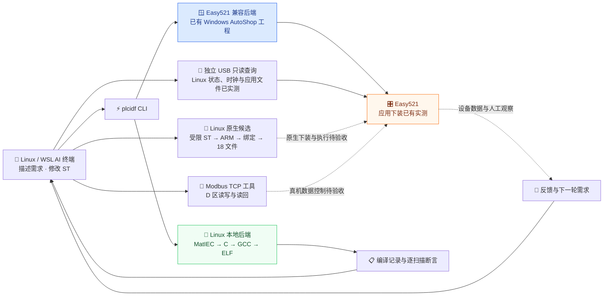

# ⚡ PLC-IDF

[](https://www.python.org/)
[](https://www.kernel.org/)
[](docs/AI_PROGRAMMING.md)
[](docs/EASY521_CLI.md)
[](https://github.com/BUG423/other-plc-idf/actions/workflows/software-tests.yml)
[](LICENSE)

> **PLC-IDF** 是面向终端 AI 的 PLC 开发工具链，对标 ESP-IDF 的开发流程，将需求描述、ST 代码、编译部署与运行反馈串联起来，提供 Linux 本地运行后端与汇川 Easy521 兼容后端。

---

## 🖼️ 工作流与系统架构



Linux 本地后端已能真实编译、执行与验收 ST。Easy521 已完成 Windows 厂商工具下装与 Y0 灯实验；原生 Linux libusb 已读回状态、变化时钟及 17 个执行/配置文件，见[真机应用读回](docs/research/firmware/32-native-application-readback-2026-10-19.md)。Linux 新 ST 编译、两级链接、既有变量绑定与 18 文件候选组合已通过本地验证；原生下装、新应用运行及修改后的两轮真机行为仍待验收。

---

## ✨ 核心特性

| 能力 | 实现与范围 |
| :--- | :--- |
| 🤖 **AI 编程与需求验收** | AI 直接修改 ST 和场景文件；`verify` 执行真实编译与逐扫描 expected/actual 断言，支持电机逻辑和 REAL 滞回示例。 |
| 🐧 **Linux 原生运行** | 固定 MatIEC 工具链，提供工程创建、构建、部署、本地运行、监测与停止；物理 I/O 和工业实时性另行验收。 |
| 🎛️ **Easy521 工程兼容** | WSL 调用已安装 AutoShop，支持已有工程 MAIN 同步、真实编译、下载与证据记录；当前保留 Windows 依赖。 |
| 🧩 **原生编译与应用候选** | Linux 受限 DINT/REAL ST 编译、两级链接、同工程 GVT/CSV 绑定；固定既有配置组合 18 文件候选。支持范围严格限定，候选不等于真机执行通过。 |
| 🔌 **数据控制与监测** | 原生 Linux 已实测状态/时钟及应用文件读取，默认预览；需可访问节点和空闲接口，host 准备另列。原生写入 API 的设备接受和执行另验；D 区业务地址须先绑定。 |
| 📝 **现场反馈** | 人工记录、仪器记录校验及多轮摘要；关联需求/程序/目标，核对日期与附件哈希，未知项保留。 |
| 📋 **可追溯记录** | 源码、构建产物、部署候选与验证结果分开记录；超时或无法核验时返回失败或 unknown，不自动重放设备写操作。 |

项目曾用名 **py2plc**，Python 包名为 `plc_idf`，命令名为 `plcidf`；`py2plc` 保留为等价命令别名。历史工程与探测档案按原貌保留。

---

## 🚀 快速上手与运行

### 1. 安装开发环境

Linux 或 WSL2 下使用 Python 3.12 及以上版本；本地 ST 编译还需要 C/C++ 编译器、Autoconf、Automake、Bison 和 Flex。

```bash
git clone --branch main https://github.com/BUG423/other-plc-idf.git
cd other-plc-idf
python3.12 -m venv .venv
source .venv/bin/activate
python -m pip install -r requirements-ci.txt -e .
```

Easy521 兼容后端另需 Windows、已安装 AutoShop 与对应设备驱动。USB 所有权切换及现场工程配置见 [Easy521 操作说明](docs/EASY521_CLI.md)。

### 2. 让 AI 编写并验证 ST

```bash
plcidf doctor --target open-linux --json
plcidf toolchain --install --local-autotools --json
plcidf new /tmp/ai_motor --target open-linux --template motor --json
plcidf verify /tmp/ai_motor --json
```

可直接向终端 AI 描述：“阅读 `/tmp/ai_motor`，将启动延时改为100ms，保留停止优先和故障联锁，补充说明设计意图及边界条件的注释，更新需求场景并执行 `plcidf verify`。”

验收结果默认保存在工程 `.plcidf/verification.json`。这里运行的是本机软件逻辑，无需额外实物；完整步骤见 [AI 编程说明](docs/AI_PROGRAMMING.md)。

### 3. 独立查询 Easy521 USB 原始数据

```bash
python tools/read_easy521_usb_runtime.py --profile gcm-state
python tools/read_easy521_usb_runtime.py --profile gcm-state --execute --busid 7-2

# 固定 M8013 时钟读取：默认预览，显式执行才访问设备。
python tools/read_easy521_usb_memory.py --profile m8013
python tools/read_easy521_usb_memory.py --profile m8013 --execute --busid 7-2
```

执行前关闭 AutoShop，并用 `usbipd list` 核对本次设备位置；`7-2` 是本次供电台架的位置，不能直接沿用到其他连接。工具在设备锁内重新枚举，只发送一次固定读取请求，保留原始响应和解释边界。当前通过 WSL 调用 Windows libusb0 驱动。`gcm-state` 沿厂商 CPU 状态链读取；默认 `literal` 属于另一条原始索引查询。用法和当前布局限制见[Easy521 操作说明](docs/EASY521_CLI.md)。

原生 Linux 后端可先离线预览：

```bash
python tools/read_easy521_usb_runtime.py --transport linux-native --profile gcm-state
```

实际读取另需将 USB 附加到 Linux、核对 Linux `BUS:ADDRESS`、节点权限与接口占用，并显式执行；默认不切换归属、解绑驱动或回退 Windows。实际控制接口0/数据接口1及本轮host准备见[原生真机记录](docs/research/firmware/25-native-linux-device-reads-2026-10-19.md)，[24号](docs/research/firmware/24-linux-native-usb-2026-10-19.md)保留初稿与前置实验。

应用文件读取同样默认零设备访问预览，凭据必须显式提供；下面的全零编码只在本台设备的读取实验中被接受：

```bash
python tools/easy521_application_usb.py \
  --remote-name userprog.foid --credential-hex 0000000000000000
```

实际执行、私有输出、超时和大文件 USB 边界见[应用协议](docs/research/firmware/26-native-application-protocol-2026-10-19.md)。带完整注释的原生构建样例见 [easy521_native_memory](examples/easy521_native_memory)，仅适用于已固定的既有变量与任务接口。

### 4. 读取或预览 Modbus 数据操作

确认真实 PLC IP 和寄存器用途后，在仓库内运行：

```bash
# PLC_IP 由实际设备地址替换；D100 仅示范地址语法。
python tools/easy521_d_control.py read --host "$PLC_IP" --d 100 --count 2

# 默认只生成写入计划，不建立连接。
python tools/easy521_d_control.py write --host "$PLC_IP" --d 100 --value 123
```

显式添加 `--execute` 才进行一次写入及读回。数据写入的业务含义由 PLC 程序决定；读回相同不证明 CPU 已扫描、输出端子动作或数值掉电保持。用法、地址绑定与实际连接证据见 [直接控制研究](docs/management/EASY521_DIRECT_CONTROL_2026-10-18.md)。

---

## 🛠️ 构建与测试

```bash
# CLI 和只读监测回归；排除真实 Windows USB 枚举。
python -m pytest src/plc_idf/tests wsl-tools/tests -q -k 'not test_devices_real_readonly'

# 离线文件契约、协议、编译工作进程和本机回环报文测试。
python -m pytest tools/tests -q
```

[GitHub Actions](https://github.com/BUG423/other-plc-idf/actions/workflows/software-tests.yml) 验证软件回归、真实 Linux ST 编译、AI 场景与独立安装。真机下载、CPU 运行、物理 I/O 和修改规则后的设备行为分别留存实测证据，软件测试不替代硬件验收。

---

## 🗂️ 工程与文档导航

| 入口 | 内容 |
| :--- | :--- |
| [AI 编程](docs/AI_PROGRAMMING.md) / [人工反馈](docs/FEEDBACK_CAPTURE.md) | 需求、ST、场景、人工/仪器记录与多轮汇总的实际用法 |
| [Easy521 闭环需求](docs/requirements/EASY521_AI_LOOP_2026-10-19.md) / [任务分工](docs/management/EASY521_AI_TASKS_2026-10-19.md) | Linux 原生目标、人工观察记录、代码注释标准和本轮分派 |
| [Easy521 操作说明](docs/EASY521_CLI.md) | 真实构建/下装记录、命令、当前限制与诊断 |
| [Y0 真机实验](docs/research/firmware/20-powered-led-bench-2026-10-19.md) / [灯程序](examples/easy521_led_blink) | 接入 24 V 后的源码、编译、下载、独立读回和人工观察 |
| [A9/B9 接线](docs/usage/EASY521_LOAD_WIRING.md) / [Linux 最新验证](docs/research/firmware/21-linux-existing-global-bindings-2026-10-19.md) | TN/TP 负载回路、真实本地闭环与 Easy521 原生构建进展 |
| [FOID 配置](docs/research/firmware/22-linux-foid-packaging-2026-10-19.md) / [原生 ST 探针](docs/research/firmware/23-linux-st-abi-2026-10-19.md) / [原生 USB](docs/research/firmware/24-linux-native-usb-2026-10-19.md) | 并行推进的严格离线检查、受限源码编译和只读通信后端，完整原生应用仍未通过 |
| [Linux USB 真机读取](docs/research/firmware/25-native-linux-device-reads-2026-10-19.md) | 控制/数据接口纠正、8次状态/时钟读取、审计守卫与host恢复，应用下载另验 |
| [原生应用协议](docs/research/firmware/26-native-application-protocol-2026-10-19.md) / [编译绑定](docs/research/firmware/27-native-bound-application-2026-10-19.md) / [配置候选](docs/research/firmware/28-fixed-application-config-2026-10-19.md) | 单次原生文件事务、新 ST 实际编译及固定接口 18 文件组合；设备运行另验 |
| [原生应用真机读回](docs/research/firmware/32-native-application-readback-2026-10-19.md) | 17 个执行/配置文件、设备哈希、USB 边界修复、历史失败和主机恢复 |
| [直接控制研究](docs/management/EASY521_DIRECT_CONTROL_2026-10-18.md) | 数据协议、CPU 模式、应用下载和底层系统的证据边界 |
| [实施计划](docs/management/PLAN.md) / [进展](docs/management/PROGRESS.md) | 任务、验收条件、分工与 GitHub 跟踪 |
| [协议与固件研究](docs/research/README.md) | 手册核验、通信实现、链接/包装及芯片资料研究 |
| [文档总导航](docs/README.md) | 需求、架构、设计决定、历史档案与审计 |
| [src/plc_idf](src/plc_idf) / [tools](tools) | CLI、目标后端与独立研究工具 |
| [examples](examples) / [plc](plc) | Linux 示例、Easy521 探针与原生工程资产 |

仓库只维护 **`main`** 分支。协作与代码注释规范见 [AGENTS.md](AGENTS.md)；原始探测、设备证据和历史报告保留其观察日期。

---

## 📄 知识产权与开源协议

本项目遵循 **[PolyForm Noncommercial 1.0.0](https://polyformproject.org/licenses/noncommercial/1.0.0)** 非商业许可，完整条款见 [LICENSE](LICENSE)：

- ❌ **商业用途需另行授权**：使用本项目须遵守许可证规定的用途与分发条件。
- 📦 **第三方组件保留原许可**：pymodbus、pyserial、编译器及厂商资产分别遵循各自条款。
- 🏷️ **历史名称保留**：旧档案中的 py2plc 指本项目，不改写历史证据。
