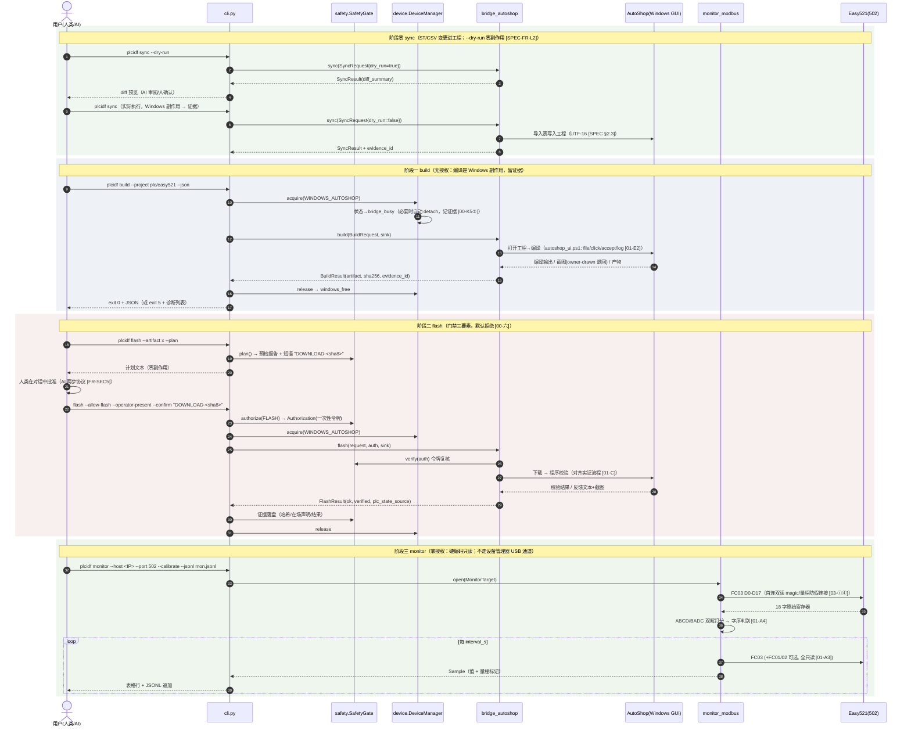
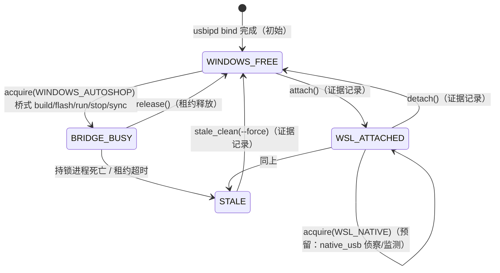

# PLC-IDF 架构设计（ARCHITECTURE）

| 项 | 值 |
|---|---|
| 文档编号 | PLC-IDF-ARCH-001（原 py2plc-ARCH-001，随 v0.2 更名） |
| 版本 / 状态 | v0.2 · 评审稿（2026-10-16） |
| v0.2 变更 | ① 更名 PLC-IDF（包 `plc_idf`，CLI `plcidf`，`py2plc` 兼容别名），与 ESP-IDF 升级为**命名对标**（§10）；② 新增 §3 源语言层（IEC 61131-3 ST）与 §6.5 工程脚手架/同步接口；③ 新增 §4 设备开放监控接口事实基线；④ §11 演进矩阵新增 **P5 底层/固件研究轨**（含安全红线）；⑤ §8 授权策略表新增 FIRMWARE 预留档 |
| 需求来源 | [需求规格说明书](../requirements/SPEC.md)（FR/NFR 编号在本文直接引用） |
| 事实依据 | [00 总纲](../wsl-feasibility/00-synthesis-and-roadmap.md) · [01 协议](../wsl-feasibility/01-protocol-facts.md) · [02 生态](../wsl-feasibility/02-opensource-ecosystem.md) · [03 实测](../wsl-feasibility/03-wsl-probe-results.md) · `wsl-probe/usb-rtu/` |
| 读者 | `src/plc_idf/` 实现者（接口签名草案即编码契约）、评审者 |

> **命名与兼容**：产品名 **PLC-IDF**，Python 包 **`plc_idf`**，CLI 命令 **`plcidf`**；`py2plc` 保留为兼容别名（仓库物理目录名暂保留）。行文统一用 `plcidf` 指代命令。
>
> **引用约定**：`[SPEC-FR-x]` = 需求文档条目；`[00-K#]` `[01-X#]` `[02-#.#]` `[03-①]` `[RTU]` 与 SPEC 相同（见 SPEC 卷首）。本文代码块为 **Python 3.12 签名草案**，实现侧应以 `src/plc_idf/backends/base.py` 等文件落地，签名可细化、语义不可偏离。

---

## 1. 架构总览

### 1.1 三个第一性结论 → 六条架构原则

| # | 第一性结论（事实依据） | 架构原则 |
|---|---|---|
| 1 | 用户要的是 ESP-IDF 式体验：单 CLI、无 GUI、数据回流、后端可替换——不是"WSL 原生"手段本身（SPEC §1.2）；项目命名 PLC-IDF 即对此的显式对标 | **P1 命令面恒定**：`build/flash/monitor` 动词永不因后端更替而变化 |
| 2 | 编译器闭源仅 Windows，**无开源 LiteST 编译器，AutoShop 是唯一编译后端** [02-2.4] [02-1.4]（SPEC §2.2）；烧录协议未逆向 | **P2 桥式先用、原生渐替**：桥式层是面对厂商闭源的**有意设计**，不是临时 hack；每层留标准插槽供原生后端替换 |
| 3 | 前端必须是文本：LD/FBD 图形语言无法 diff/review/AI 生成，ST 是唯一可代码化的 IEC 语言（SPEC §2.1）；ST+CSV→AutoShop 导入工作流已实证 | **P3 文本化前端 + 数据面先行**：ST/CSV 承载全部用户逻辑；监测/仿真零 Windows 依赖先成闭环，编译/烧录经桥式跟进 |
| 4 | 监控协议开放（Modbus TCP [01-A3]）而编译/下载协议私有 [02-1.4]——不对称是事实（[ARCH-§4]） | **P4 分层消解不对称**：监测走原生开放协议，编译/烧录走桥式，各自独立演进 |
| 5 | 红线：真机默认只读；写/RUN/STOP/下载须明确授权且在场 [00-六]；固件级实验更须单独授权（P5） | **P5 默认拒绝**：安全门禁在 CLI 层统一实施，后端只接受签发的授权凭据，不自查旗标 |
| 6 | USB 与 AutoShop 互斥；TUN 假连接；Hyper-V 防火墙 [00-K5] [03-①] | **P6 环境敌意假设**：设备所有权由单一管理器调度；一切网络连接默认可疑，须过防假校验 |
| 7 | GUI 驱动脚本不应作为无人监督的硬件部署脚本 [01-E2] | **P7 一切副作用留证据**：证据是一等输出物，不是日志副产品 |

### 1.2 一句话架构

**一个稳定的 CLI 命令面（`plcidf`），压在文本化 ST 前端与三个后端接口（Build / Flash / Monitor）之上；接口之下，今天跑桥式（Windows 当不可见的唯一编译服务器）与 Modbus 原生（数据面），明天逐个换成原生后端；安全门禁与设备互斥横切所有后端，一切真机副作用落证据。**

---

## 2. 分层架构图

```
┌─────────────────────────────────────────────────────────────────────────────┐
│ 用户层：人类开发者(U1) ｜ AI Agent(U2, 一等用户)                                │
│         plcidf init/new ｜ sync ｜ build ｜ flash ｜ monitor ｜ sim            │
│                    ｜ device ｜ evidence ｜ backends                          │
├─────────────────────────────────────────────────────────────────────────────┤
│ 源语言层（IEC 61131-3 ST，唯一文本化前端 [ARCH-§3]）                             │
│   *.st 正文  ｜  *_variables.csv 变量表  ｜  modbus_register_map_real32.csv 契约│
│   （可 diff / 可 review / 可 AI 生成；编译语义不在本层 [SPEC-FR-L4]）             │
├─────────────────────────────────────────────────────────────────────────────┤
│ CLI 层  src/plc_idf/cli.py                                                    │
│   子命令解析 · --json 输出 · 退出码(NFR-REL2) · --plan 两步授权协议(FR-SEC5)     │
├─────────────────────────────────────────────────────────────────────────────┤
│ 横切层（对所有后端生效）                                                        │
│   safety.py  授权门禁 SafetyGate：策略表→旗标+在场+确认短语→Authorization 令牌   │
│              证据写入（append-only JSONL + 截图引用）     [SPEC-FR-E*]          │
│   device.py  设备管理器 DeviceManager：USB 所有权状态机 + 租约锁  [ARCH-§9]      │
├─────────────────────────────────────────────────────────────────────────────┤
│ 后端接口层  backends/base.py（Python Protocol + 数据类，[ARCH-§6]）             │
│   BuildBackend        FlashBackend         MonitorBackend/MonitorSession      │
│  （编译仅 AutoShop     （默认拒绝的插槽）      （硬编码只读 [SPEC-FR-M1]）        │
│    [SPEC-FR-L4]）                                                            │
├─────────────────────────────────────────────────────────────────────────────┤
│ 后端实现层（同一插槽、可替换实现，[ARCH-§11] 替换矩阵）                           │
│   bridge_autoshop   编译+烧录+工程同步（桥式）   monitor_modbus   监测（原生网口） │
│   sim_virtual       监测+静态检查              native_usb      预留（P3 后评估） │
├─────────────────────────────────────────────────────────────────────────────┤
│ 执行环境层                                                                    │
│   Windows：AutoShop V4.11.0.5（GUI，唯一编译后端）+ autoshop_ui.ps1 驱动 + usbipd│
│   WSL：pymodbus 3.16.x ｜ virtual_easy521.py ｜ /dev/ttyACM0(attach 后)        │
├─────────────────────────────────────────────────────────────────────────────┤
│ 目标层：Easy521 真机（Modbus TCP 502 主通道 ｜ USB CDC bulk 私有协议 [ARCH-§4]）  │
│         虚拟 Easy521（127.0.0.1:1502，契约同源 [00-四]）                         │
└─────────────────────────────────────────────────────────────────────────────┘
```

要点：**CLI 层之下没有任何一层知道"WSL 原生"是不是目标**——各层只认识后端接口。桥式层（bridge_autoshop）与原生层（monitor_modbus/sim_virtual）在接口之下平级，这正是"后端可替换"的结构保证（P1/P2）。源语言层只产出文本与契约数据，**从不编译**——它是纯前端，这让"AutoShop 唯一编译后端"的事实约束（SPEC §2.2）不会渗漏成架构妥协。

---

## 3. 源语言层：IEC 61131-3 ST

### 3.1 为什么是 ST（选型论证）

Easy521/AutoShop 支持的 IEC 61131-3 语言中，LD/FBD 是**图形语言**：语义寄于图形布局，无规范文本序列化，无法 diff、无法 review、无法由 AI 生成或重构——与"AI 一等用户"的闭环定位根本冲突。ST 是唯一**完全文本化**的选项（类 C 语法、逐行 diff、PR review、与现有 Python→ST 算法移植线 [00-四] 同构）。IL 虽是文本但属低层汇编风格且已被 IEC 61131-3:2011 标记弃用方向，SFC 主体仍是图形。选型论证全表见 [SPEC §2.1]。

### 3.2 职责边界（红线）

| 在 WSL 侧（PLC-IDF 承担） | 只在 Windows/AutoShop（PLC-IDF 不承担） |
|---|---|
| `init/new`：ST+CSV 工程脚手架（FR-L1） | **编译**：LiteST → 机器码，闭源 DLL，无开源替代（C1） |
| 编辑：`.st` 正文 + `*_variables.csv`（人/AI） | 导入执行的最终解释（导入表格式以 AutoShop 版本为准） |
| 静态检查：LiteST 方言边界（无 `LREAL`、≤1000 行）+ 变量表↔寄存器契约一致性（FR-L3，C13） | 下载/上载/在线监控的私有协议通道（C2） |
| 虚拟仿真、监测、编排、证据 | — |

**任何"WSL 内编译 ST"的功能都是虚构，明文禁止**（[SPEC-FR-L4]）。本层产出的一切文本都是 AutoShop 的**输入**，不是编译结果。

### 3.3 数据流（文本 → 厂商工程）

```
 *.st + *_variables.csv (WSL, 可 diff)
        │  plcidf sync（FR-L2：导入表驱动，--dry-run diff 预览先行）
        ▼
 autoshop_global_import.csv / autoshop_fb_import.csv   ← 格式已实证 [SPEC §2.3]
        │  （UTF-8 → UTF-16 转码；bridge 经 AutoShop 文件导入对话框/导入表完成）
        ▼
 AutoShop 工程（.hcp 等，厂商私有格式 [01-F]）
        │  plcidf build（bridge_autoshop 驱动 GUI 编译）
        ▼
 编译产物 → plcidf flash（授权门禁）→ 真机
```

已有资产实证该工作流：`plc/easy521/` 的两个 ST 正文、两个变量 CSV 与两份导入表"已成功导入"真实 AutoShop 4.11 工程（含 UTF-16 编码注意事项、LiteST 无 `LREAL` 的方言约束）[SPEC §2.3]。`plcidf init/new/sync` 只是把这条人工流程自动化，不引入新编译语义。

### 3.4 接口落点

脚手架（init/new）为纯本地文本操作，属 `cli.py` 职责；`sync` 触碰 Windows 侧工程文件，必须经桥式后端并走证据链——接口见 [ARCH-§6.5]。

---

## 4. 设备开放监控接口（事实基线）

回答"板子是否提供监控接口"。三档通道及其架构含义（事实详表见 [SPEC §3]）：

| 档 | 通道 | 事实要点 | 架构落点 |
|---|---|---|---|
| **主通道（开放）** | 以太网 Modbus TCP | 502 出厂默认开启、D0-D7999↔FC03 直映、不校验站号、协议三方互证 [01-A3] [02-1.1] | `monitor_modbus` 后端的真机形态（P4 起主位）；NFR-PORT5 仅换 `--host` |
| **备选（协议开放/硬件 TBD）** | RS485 Modbus RTU | RTU 从站映射与以太网完全相同 [01-A3]；**Easy521-0808TN 的 RS485 端口有无待复核（TBD）** | `monitor_modbus` 串行传输已备 [wsl-tools/README §3]，承诺级别降为"保留"，开放问题 O9 |
| **逆向对象（私有）** | USB 编程口 | 纯 CDC 拓扑（bulk 0x02/0x81 [00-K2]）、协议零逆向、已证伪非 RTU [RTU] | `native_usb` 预留插槽（P3 抓包评估后决定）；当前仅作 Windows 侧桥式资源 |

另有一条与本产品无关但须知道的通道：**USB 固件升级**（编程手册 §26.2.1 [01-B]）——属 P5 底层/固件研究轨，默认冻结（[ARCH-§11]）。

设计含义（P4 原则）：监控协议开放而编程协议私有这一**不对称**，被"监测原生 + 编译烧录桥式"的分层直接消解——两半各自沿最优路径演进，互不阻塞。

---

## 5. 模块职责

目录树（与实现侧约定的结构一致，随 v0.2 更名）：

```
src/plc_idf/
├── __init__.py
├── cli.py                      # 子命令：init/new/sync/build/run/stop/monitor/sim/device/evidence/backends
├── safety.py                   # SafetyGate / SafetyAction / Authorization / 证据写入
├── device.py                   # DeviceManager / DeviceState 状态机 / 租约锁
└── backends/
    ├── __init__.py             # 注册表 REGISTRY + get_backend()（[ARCH-§6.6]）
    ├── base.py                 # 全部 Protocol 与数据类（[ARCH-§6]），零第三方依赖
    ├── bridge_autoshop.py      # BuildBackend + FlashBackend + 工程同步（桥式：Windows 唯一编译后端）
    ├── monitor_modbus.py       # MonitorBackend（Modbus TCP + RS485 RTU 传输）
    ├── sim_virtual.py          # MonitorBackend + 离线检查（虚拟闭环，包 wsl-tools 资产）
    └── native_usb.py           # 预留插槽（P3 抓包评估后决定，[00-五P3]）
```

| 模块 | 职责 | 明确不做 | 关联需求 |
|---|---|---|---|
| `cli.py` | 命令面、参数解析、`--json/--plan`、退出码、trace id、ProgressSink 装配；**工程脚手架 `init/new`（纯本地文本操作，模板随包分发）** | 不含业务逻辑与协议细节；**不读环境决定授权**（只透传旗标给 SafetyGate）；不实现任何编译 | [SPEC-FR-X2]、FR-L1、NFR-OBS1 |
| `safety.py` | 授权策略表（[ARCH-§8.2]）、确认短语派生、Authorization 签发与校验、证据 JSONL 追加、`evidence` 子命令数据访问 | 不执行任何操作本身；不缓存授权（FR-SEC3） | [SPEC-FR-SEC*]、FR-E* |
| `device.py` | USB 所有权状态机、租约锁落盘与陈旧检测、attach/detach 编排（调 usbipd）、设备身份建档 | 不触碰 PLC 应用状态；不做字序/量程校验 | [SPEC-FR-D*] |
| `backends/base.py` | 接口与数据类唯一定义处（对齐 `e521_regs.py` 作为契约唯一定义处的风格 [00-四]） | 不 import 任何后端实现（防依赖倒置） | [SPEC-FR-X1] |
| `bridge_autoshop.py` | 驱动 AutoShop GUI 完成编译/下载/校验（经 `autoshop_ui.ps1`：inspect/file/accept/log/screenshot [01-E2]）；owner-drawn 输出退回截图；弹窗 accept 策略；**工程同步 `sync`（导入表驱动，[ARCH-§6.5]）** | 不绕过门禁自查旗标；不做无人监督写操作（C9）；不实现编译语义（编译在 AutoShop） | [SPEC-FR-B1~B5、F1~F7、L2] |
| `monitor_modbus.py` | Modbus TCP/RTU 只读采集、`--calibrate` 字序判别、防假连接校验、表格+JSONL | **源码面禁止出现写功能码**（[ARCH-§8.3]）；不写 PLC | [SPEC-FR-M1~M5、M7] |
| `sim_virtual.py` | 包 `wsl-tools/virtual_easy521.py`（三场景）为 MonitorBackend；静态检查承载点（FR-L3） | 不声称厂商等价编译（FR-B6/L4） | [SPEC-FR-M6、S1~S3、B6、L3] |
| `native_usb.py` | P3 后：pyusb bulk 端点（0x02/0x81 [00-K2]）帧协议实验 | 本期不实现；注册表中标注"预留" | [SPEC-FR-M8]、[ARCH-§11] |

---

## 6. 后端接口定义（Python Protocol 签名草案）

### 6.1 公共数据类与 ProgressSink（`backends/base.py`）

```python
# src/plc_idf/backends/base.py —— 接口唯一定义处，仅标准库
from __future__ import annotations
from collections.abc import Iterator
from dataclasses import dataclass, field
from enum import StrEnum
from pathlib import Path
from typing import Protocol, runtime_checkable


@dataclass(frozen=True)
class EnvironmentReport:
    backend: str
    ok: bool
    problems: list[str] = field(default_factory=list)   # 人读 + --json 双用
    details: dict[str, str] = field(default_factory=dict)  # 版本/路径等事实


@dataclass(frozen=True)
class Diagnostic:
    severity: str                 # "error" | "warning" | "info"
    message: str
    source: str                   # "autoshop-log" | "screenshot" | "static-check" | "sync-diff" ...
    hint: str | None = None


@dataclass(frozen=True)
class Artifact:
    path: Path
    sha256: str                   # 产物不可抵赖 [SPEC-FR-B2]
    kind: str = "firmware"        # 预留多产物


@dataclass(frozen=True)
class BuildResult:
    ok: bool
    artifacts: list[Artifact]
    diagnostics: list[Diagnostic]
    evidence_id: str              # 证据条目 ID [SPEC-FR-E1]


@dataclass(frozen=True)
class FlashResult:
    ok: bool
    verified: bool                # 程序校验结果 [SPEC-FR-F3]
    plc_state_source: str | None  # 状态来源声明，禁止虚构 [SPEC-FR-F7]
    evidence_id: str


class ProgressEventKind(StrEnum):
    STEP = "step"          # 阶段推进
    MESSAGE = "message"    # 人读消息
    METRIC = "metric"      # 数值（监测值/进度百分比）
    EVIDENCE = "evidence"  # 证据产出（截图/日志路径）


@runtime_checkable
class ProgressSink(Protocol):
    """进度事件汇：CLI 装配，后端只调用。事件同步进证据（NFR-OBS2/3）。"""
    def event(self, kind: ProgressEventKind, message: str, /, **fields: str) -> None: ...
```

### 6.2 BuildBackend

```python
@dataclass(frozen=True)
class BuildRequest:
    project_dir: Path             # ST 源 + 变量 CSV + AutoShop 工程资产根目录
    target: str = "Easy521-0808TN"
    out_dir: Path = Path("build")
    clean: bool = False


class BuildBackend(Protocol):
    name: str                                        # "bridge_autoshop" | "sim_virtual"

    def check_environment(self) -> EnvironmentReport: ...
    def build(self, request: BuildRequest, *, sink: ProgressSink) -> BuildResult:
        """编译。唯一具备厂商编译语义的后端是 bridge_autoshop（C1/SPEC-FR-L4）；
        sim_virtual 只做静态检查/离线验证包。调用前 CLI 已取得 WINDOWS_AUTOSHOP 租约；
        实现内部只驱动 AutoShop，不做授权判断（门禁在 safety.py）。"""
```

### 6.3 FlashBackend

```python
class SafetyAction(StrEnum):   # 实际定义于 safety.py，此处为语义引用
    READ = "read"; ATTACH = "attach"; DETACH = "detach"
    WRITE = "write"; FLASH = "flash"; RUN = "run"; STOP = "stop"
    FIRMWARE = "firmware"         # P5 预留：立项前不出现在任何命令面（[ARCH-§11]）


@dataclass(frozen=True)
class Authorization:
    """由 SafetyGate.authorize() 签发的一次性凭据；后端只消费，不构造。
    后端执行前必须调用 gate.verify(auth, action) 复核（防误用/过期）。"""
    action: SafetyAction
    token: str                    # 随机一次性令牌（FR-SEC3）
    trace_id: str
    issued_at: float
    operator_present: bool        # 在场声明（声明式，进证据，FR-SEC5）


@dataclass(frozen=True)
class FlashRequest:
    artifact: Path
    target: str = "Easy521-0808TN"
    verify_after: bool = True     # 下载后程序校验，默认强制 [SPEC-FR-F3]
    source_project: Path | None = None   # 预检目标匹配用 [SPEC-FR-F4]


class FlashBackend(Protocol):
    name: str

    def check_environment(self) -> EnvironmentReport: ...
    def plan(self, request: FlashRequest) -> str:
        """零副作用预检：返回计划文本 + 确认短语（DOWNLOAD-<sha8>）。
        AI 两步协议的第一步（FR-SEC5）。"""
    def flash(self, request: FlashRequest, *, auth: Authorization,
              sink: ProgressSink) -> FlashResult:
        """auth.action 必须 == FLASH，且 token 未用过。"""
    def run(self, *, auth: Authorization, sink: ProgressSink) -> FlashResult: ...
    def stop(self, *, auth: Authorization, sink: ProgressSink) -> FlashResult: ...
```

### 6.4 MonitorBackend / MonitorSession（硬编码只读）

```python
@dataclass(frozen=True)
class MonitorTarget:
    transport: str                # "tcp" | "serial" | "virtual"
    host: str | None = None       # tcp：真机 IP 或 127.0.0.1
    port: int = 502               # 手册：从站默认 502 [01-A3]；虚拟从站 1502
    device: str | None = None     # serial：/dev/ttyUSB0（RS485 适配器，非编程 USB [RTU]）
    baud: int = 9600; parity: str = "N"; stopbits: int = 1   # 8N1 默认，实测为准
    unit_id: int = 1              # 从站不校验站号 [01-A3]
    word_order: str | None = None # None → 首连必须 calibrate [01-A4]


@dataclass(frozen=True)
class Sample:
    ts: float
    registers: tuple[int, ...]            # 原始字
    values: dict[str, float]              # 量名 → 解码值（契约 9 量 [00-四]）
    word_order: str
    flags: dict[str, str] = field(default_factory=dict)  # "range_Vpu": "ok" 等


class WordOrderReport(StrEnum):
    ABCD = "abcd"; BADC = "badc"; INDETERMINATE = "indeterminate"  # 如实报并列 [FR-M3]


class MonitorSession(Protocol):
    """只读会话：本 Protocol 刻意不含任何写方法 —— 类型级安全边界（[ARCH-§8.3] 第②层）。"""
    def calibrate(self) -> WordOrderReport: ...
    def anti_fake_check(self) -> bool:
        """签名寄存器双读 + 量程合理性（模拟器 D523 magic=521 [01-G]；
        疑 TUN 假连接 → False，CLI 拒绝除非 --accept-unverified-transport [03-①④]）。"""
    def snapshot(self) -> Sample: ...
    def stream(self, interval_s: float = 1.0, *,
               jsonl_path: Path | None = None) -> Iterator[Sample]: ...
    def close(self) -> None: ...


class MonitorBackend(Protocol):
    name: str                                     # "monitor_modbus" | "sim_virtual" | "native_usb"

    def check_environment(self) -> EnvironmentReport: ...
    def open(self, target: MonitorTarget) -> MonitorSession: ...
```

> pymodbus 3.16 实现注意：站号走 `device_id=`（`slave=` 已更名）[03-②]；单帧上限 FC03 读 125 字，契约 18 字无分帧问题 [02-1.2]。

### 6.5 工程脚手架与同步接口（v0.2 新增，承载 FR-L1/L2）

```python
# init/new 为 cli.py 的纯本地文本操作（模板随 plc_idf 包分发），不经过后端接口。
# sync 触碰 Windows 侧工程文件，必须是 bridge_autoshop 的显式能力：


@dataclass(frozen=True)
class SyncRequest:
    project_dir: Path             # ST 正文 + 变量 CSV 源目录
    autoshop_project: Path        # Windows 侧 AutoShop 工程目录
    dry_run: bool = True          # 默认只出 diff 预览（零 Windows 副作用）


@dataclass(frozen=True)
class SyncResult:
    ok: bool
    diff_summary: list[Diagnostic]   # 改了哪些变量/正文段落（source="sync-diff"）
    evidence_id: str                 # 实际同步属 Windows 副作用，强制证据 [FR-E1]


class ProjectSync(Protocol):
    """bridge_autoshop 的附加能力：导入表驱动的 ST/CSV → AutoShop 工程同步。
    只搬运工程数据，不产生编译语义（[SPEC-FR-L4]）。"""
    def sync(self, request: SyncRequest, *, sink: ProgressSink) -> SyncResult: ...
```

### 6.6 后端注册表（`backends/__init__.py`）

```python
REGISTRY: dict[str, BackendEntry] = {
    # name             类                       层                    状态
    "bridge_autoshop": BackendEntry(BridgeAutoshopBackend, {"build", "flash", "sync"}, "active"),
    "monitor_modbus":  BackendEntry(ModbusMonitorBackend,  {"monitor"},            "active"),
    "sim_virtual":     BackendEntry(SimVirtualBackend,     {"build", "monitor"},   "active"),
    "native_usb":      BackendEntry(None,                  {"build", "flash", "monitor"}, "reserved"),
}

def get_backend(name: str, layer: str) -> BuildBackend | FlashBackend | MonitorBackend: ...
def backends_doctor() -> list[EnvironmentReport]: ...   # plcidf backends doctor [FR-X3]
```

规则：新后端 = 新文件实现对应 Protocol + `REGISTRY` 一行，`cli.py` 零改动 [SPEC-FR-X2]。`reserved` 条目必须在 `doctor` 中如实报"未实现" [FR-M8]。

### 6.7 退出码（NFR-REL2，全命令一致）

| 码 | 含义 | 典型场景 |
|---|---|---|
| 0 | 成功 | — |
| 2 | 用法错误 | 参数缺失/非法 |
| 3 | 环境不满足 | doctor 不通过、后端依赖缺失 |
| 4 | **授权拒绝** | 门禁三要素缺一（FR-SEC1） |
| 5 | 后端执行失败 | 编译错误、下载校验失败、监测中断、静态检查不过 |
| 6 | 设备冲突 | 租约被占、状态机拒绝转移 |

---

## 7. 关键数据流：sync → build → flash → monitor 时序



四条不变量：(1) 授权只发生在 safety.py，后端只消费凭据（P5 原则）；(2) flash/run/stop 全程持租约，monitor 与 sync 的 dry-run 不占用 USB；(3) 每阶段产出证据或结构化结果，无静默副作用（P7）；(4) **全链路从 ST 文本开始，机器码只在 AutoShop 内诞生**（[ARCH-§3.2] 红线）。

---

## 8. 安全机制设计

### 8.1 威胁模型

| 威胁 | 场景 | 对策 |
|---|---|---|
| T1 误写真机 | AI/人误触发写、RUN、下载 | 门禁默认拒绝（[ARCH-§8.2]）+ monitor 类型面无写（§8.3） |
| T2 确认后换包 | 授权短语与产物脱钩 | 短语派生自产物 SHA-256（FR-SEC2） |
| T3 假连接假数据 | TUN fake-accept 劫持 [03-①] | 签名双读 + 量程校验 + 显式放行（FR-M5） |
| T4 并发抢占 | flash 进行中另一会话 attach 设备/AutoShop 被抢 | 设备租约互斥（[ARCH-§9]） |
| T5 抵赖/无法追溯 | 事后说不清谁在何时改了 PLC | append-only 证据 + 哈希链 + 截图（FR-E1~E4） |
| T6 陈旧锁死锁 | 持锁进程崩溃 | 租约含 PID/boot id，陈旧检测 + 显式清理留痕（FR-D3） |
| T7 固件级误操作（变砖） | P5 研究轨误触固件升级/调试口写 | FIRMWARE 动作单独授权档、立项前命令面不存在、变砖风险前置声明（FR-SEC7，[ARCH-§11]） |

### 8.2 授权门禁（`safety.py`）

策略表（单一事实源，CLI 与后端都不得绕过）：

| SafetyAction | 触发命令 | 显式旗标 | 在场声明 | 确认短语 | 证据 | 默认 |
|---|---|---|---|---|---|---|
| READ | monitor | 不需要 | 不需要 | 不需要 | 仅 JSONL 数据流 | **允许** |
| ATTACH / DETACH | device | 不需要 | 不需要 | 不需要 | 强制记录 | 允许（不触碰 PLC 状态，但改变 Windows/AutoShop 可用性 [00-K5③]） |
| WRITE | （预留，当前无后端使用） | `--allow-write` | 需要 | 需要 | 强制 | **拒绝** |
| FLASH | flash | `--allow-flash` | 需要 | `DOWNLOAD-<sha8>` | 强制 | **拒绝** |
| RUN | run | `--allow-run` | 需要 | `RUN-<sha8>` | 强制 | **拒绝** |
| STOP | stop | `--allow-stop` | 需要 | `STOP-<plan8>` | 强制 | **拒绝** |
| FIRMWARE | （P5 预留，立项前命令面不存在） | 单独授权协议（**不复用** flash/run 旗标） | 需要 | 需要 | 强制 | **拒绝**（[ARCH-§11] P5 红线） |

`<sha8>` = 操作对象（产物文件 / 计划文档 canonical JSON）的 SHA-256 前 8 位，由 `--plan` 打印。短语逐字比对。

```python
# src/plc_idf/safety.py 关键签名
class SafetyGate:
    def __init__(self, evidence_dir: Path, *, interactive: bool) -> None: ...
    def plan(self, action: SafetyAction, subject: dict[str, str]) -> str:
        """零副作用：打印计划 + 确认短语（两步协议第一步）。"""
    def authorize(self, action: SafetyAction, *, flag_given: bool,
                  operator_present: bool, confirm_phrase: str | None,
                  subject: dict[str, str]) -> Authorization:
        """三要素齐备才签发；任一缺失 → AuthorizationDenied（exit 4）。
        签发即写证据（attempt 条目，含成功/拒绝）。"""
    def verify(self, auth: Authorization, action: SafetyAction) -> None:
        """后端执行前复核：令牌未用、动作匹配、未过期；用后即焚。"""
```

设计决策说明：
- **门禁在 CLI 层统一执行，后端不自查旗标**——防止某后端"忘了检查"；后端只认 `Authorization` 凭据（P5 原则）。
- **授权不可持久化**：无 `--yes`、无配置文件记忆、无环境变量开关（FR-SEC3）。每次操作重新走三要素，代价是一次复制粘贴，收益是不可绕过。
- **`--operator-present` 是声明式控制**：技术上无法验证人类在场，因此 (a) 进证据供事后审计，(b) SPEC A2 假设将其定为组织约定——AI 只可在人类于本会话明确批准该操作后置位（FR-SEC5）。这是诚实的设计：不假装技术控制能覆盖组织问题。
- **FIRMWARE 独立成档**：固件级实验风险等级高于任何用户工程操作（变砖），不复用任何既有授权旗标，且 P5 立项前该动作在代码中不存在（FR-SEC7）。

### 8.3 monitor 只读的四层防线（纵深防御）

| 层 | 机制 | 失效假设 |
|---|---|---|
| ① CLI 面 | `monitor` 子命令不存在任何写相关参数（对照：flash/run/stop 全在 monitor 之外） | AI/人无法从命令面表达写意图 |
| ② 类型面 | `MonitorSession` Protocol 无写方法；实现类不得新增 public 写方法（review + 静态检查） | 调用方拿到会话也无处可写 |
| ③ 实现面 | 后端源码仅 import 读调用（`read_holding_registers/read_coils/read_discrete_inputs/read_input_registers`），对齐 wsl-tools 既有硬边界 [wsl-tools/README §2] | 即使改代码，diff 一目了然 |
| ④ 对端面 | 虚拟从站对写功能码回异常（既有行为 [00-四]）；真机侧由"上位机只读"组织约束兜底 | 纵深兜底 |

测试锁死：静态扫描测试（③）+ 端到端写拒绝测试（④）纳入回归（AC-2）。

### 8.4 证据机制（`safety.py` 内实现数据访问）

- 位置：`evidence/<UTC日期>/<trace_id>/`——`events.jsonl`（append-only）+ 截图/日志文件；schema 带 `schema_version`（FR-E4）。
- 条目字段：`ts, trace_id, actor("human"|"ai:<session>"), action, backend, subject_sha256, operator_present, result, refs[]`。
- `evidence verify`：重算条目链哈希 + 产物哈希存在性核对（T5 对策）。
- 编译/下载/同步关键步骤的截图由 bridge_autoshop 经 ProgressSink `EVIDENCE` 事件推送落盘（[01-E2] 能力边界内）。

---

## 9. 设备互斥状态机（`device.py`）

USB 编程口同时只能有一个主人：WSL（attach 后 `/dev/ttyACM0`）或 Windows（AutoShop 经 libusb0 驱动 bulk 端点 [00-K2]）。这是实测确认的互斥约束 [00-K5③]，因此**所有权切换只能经设备管理器**，任何后端不得私自调用 usbipd。



| # | 当前态 | 事件 | 动作 | 次态 | 拒绝条件（exit 6） |
|---|---|---|---|---|---|
| T1 | WINDOWS_FREE | attach | usbipd attach --wsl；建档 | WSL_ATTACHED | — |
| T2 | WSL_ATTACHED | detach | usbipd detach；归还 | WINDOWS_FREE | — |
| T3 | WINDOWS_FREE | acquire(WINDOWS_AUTOSHOP) | 落租约锁 | BRIDGE_BUSY | 已有租约（T4/T6 兜底） |
| T4 | BRIDGE_BUSY | acquire(任意) | — | 不变 | 租约被占 → 提示持有者（T4） |
| T5 | BRIDGE_BUSY | attach / detach | — | 不变 | **桥式会话期间禁止切换所有权** |
| T6 | 任意 | acquire 时陈旧检测 | 报 STALE | STALE | 需 `stale-clean --force` 才能继续 |
| T7 | NETWORK（网口模式） | 任意 | 不涉 USB，仅记录 | 不变 | — |

租约锁协议：`<repo>/.plcidf/device.lease.json` = `{state, purpose, pid, boot_id, ts, holder}`；陈旧判定 = PID 不存活或 boot_id 变化或超 TTL；`stale-clean` 清理并写证据（T6）。`device status` 读取即校验，不做隐式清理。

设计决策：**attach/detach 不需要授权旗标但强制证据**（[ARCH-§8.2] 策略表）——它不改变 PLC 应用状态，但会中断 AutoShop 可用性，属于"低风险高干扰"操作，用可见性而非闸门管理。桥式会话内的 T5 拒绝则保护"下载中途 USB 被抢走"这一真实事故面。

---

## 10. 与 ESP-IDF 的对照（命名对标）

项目名 **PLC-IDF** 即定位声明：以 ESP-IDF 为模板的**命名级对标**——不是风格类比，而是命令面、工作流、源语言形态的逐项对齐，差异全部来自目标硬件生态：

| 维度 | ESP-IDF | PLC-IDF | 说明 |
|---|---|---|---|
| CLI | `idf.py build / flash / monitor` | `plcidf build / flash / monitor` | **同构动词**；包名 `plc_idf` ↔ `esp-idf` 同级 |
| 源语言 | C / C++（全文本） | **IEC 61131-3 ST**（全文本，[ARCH-§3]） | 文本化对文本化；LD/FBD 图形语言被排除（SPEC §2.1） |
| 编译执行体 | 开源 GCC 工具链，本地 | **bridge_autoshop**（Windows 当不可见的唯一编译服务器） | 厂商闭源所致 [02-2.4]；这是两生态最本质差异 |
| 烧录 | esptool（开源 bootloader 协议） | FlashBackend 插槽：现桥式，未来 `native_usb` | esptool 协议公开；Easy521 下载协议未逆向 [02-1.4] → 同插槽换实现 |
| monitor | idf_monitor（USB 串口日志文本） | monitor_modbus（Modbus TCP 数据面寄存器）| 数据回流语义等价，介质不同 [ARCH-§4] |
| 串联 | `idf.py build flash monitor` 一键 | 分步 + flash 单独授权确认 | **有意取舍**：授权门禁（P5 原则）优先于一键便利 |
| menuconfig | 有（Kconfig） | 无 | 工程配置即文件（CSV 契约/导入表），无需菜单系统 |
| JTAG/OpenOCD | 有 | —（无对应） | Easy521 无公开调试口协议；底层探索归 P5 研究轨（[ARCH-§11]） |
| 后端结构 | 单一开源工具链 | 多后端插槽 | **ESP-IDF 无需桥式层**（全开源）；PLC-IDF 的桥式层是面对厂商闭源的**有意设计**——把"暂时只能这样"封装成"随时可以换"（P1/P2） |

---

## 11. 演进路线（后端替换矩阵 + 研究轨）

对齐 00 总纲路线图 [00-五]，表达为"同一插槽、更换实现"；P5 为与主线**正交**的研究轨：

| 阶段 | 触发条件 | BuildBackend | FlashBackend | MonitorBackend | 用户命令面 |
|---|---|---|---|---|---|
| **P1 软件闭环**（✅ 完成 [00-五]） | — | sim_virtual（静态检查） | （无，默认拒绝） | sim_virtual（虚拟从站） | 不变 |
| **P2 桥式全链**（进行中，人在场） | USB 单线即可 [00-五P2] | **bridge_autoshop**（+sync） | **bridge_autoshop** | monitor_modbus（虚拟→真机待网口） | 不变 |
| **P3 抓包评估**（待立项 [00-五P3]） | USBPcap 抓 AutoShop 会话 → 帧结构分析；产出进 `docs/research/` | bridge_autoshop | bridge_autoshop（若帧结构可逆向 → 启动 native_usb 原型） | monitor_modbus + native_usb 原型 | 不变 |
| **P4 网口直连/原生**（待拓展坞 [00-五P4]） | 网线 + IP 发现 + 字序真机标定 | bridge_autoshop | bridge_autoshop（网口下载协议同样未逆向，仍桥式） | **monitor_modbus 升主位**（真机 502，零 Windows 依赖） | 不变 |
| **P5 底层/固件研究轨**（并行长线，**默认冻结**） | 用户**单独立项授权** | —（不触及） | —（不触及） | —（不触及） | 不变（立项前无命令面） |
| **终态** | 分层收敛 | 原生（若 autoshop-mcp H5U/ST 适配成熟 [02-2.4] 或逆向成功）/ **否则桥式长期保留** | native_usb（若 P3 立项成功）/ 否则桥式 | monitor_modbus / native_usb 双后端并存 | 不变 |

**P5 研究轨内容**：(a) AutoShop 固件升级通道抓包评估（USB 固件烧录流程，编程手册 §26.2.1 [01-B]）；(b) **sunxi 公开生态利用**——主控自述 `Linux 3.10.65 with sunxi_usb_udc`（全志平台 [00-K1]），FEL 下载模式/串口控制台等公开资源调研；(c) 调试口排查（UART 焊点/引脚，纯目视与文档级）。产出全部进 `docs/research/`，与 P3 抓包区共用管理规则。

**P5 安全红线（前置声明）**：
1. **一切固件级实验默认禁止接触真机**——文档研究、抓包离线分析不受限，任何发往真机的固件/调试口操作受限；
2. 须用户**单独授权**（SafetyAction.FIRMWARE 独立档，不复用 flash/run 授权，[ARCH-§8.2]），且逐次实验逐一授权，不存在"研究期总授权"；
3. **变砖风险前置声明**：固件操作可能使 PLC 不可启动且无法自行恢复；每次实验前须向用户复述此风险并留声明证据（FR-SEC7）。

演进的判据（诚实声明）：**编译环节可能永远无法完全去 Windows 化**——编译器是厂商闭源 DLL，合法获取编译能力的路径只有 AutoShop 本体或其 DLL [02-2.4]。因此终态的合理形态是"monitor 全原生 + flash 按逆向进展渐进原生 + build 长期桥式"，而这在架构上已经成立：桥式只是插槽里的一个实现，不是架构的特例。P5 不改变这一判断——它是知识探索轨，不是主线依赖。

---

## 12. 风险与对策

| # | 风险 | 等级 | 对策 | 依据 |
|---|---|---|---|---|
| R1 | GUI 驱动的桥式编译脆弱（弹窗/焦点/owner-drawn 输出读不出） | 高 | accept/log/screenshot 组合策略；owner-drawn 一律退回截图 [01-E2]；失败恢复 GUI 可用状态（NFR-REL4）；证据留痕便于复盘 | 01-E2 |
| R2 | 软件 RUN 失败根因未明（拨码假设待证） | 高 | run 结果只记录不臆断（FR-F5/F7）；首次真机联调先核面板拨码与灯 [01-D]；AC-6/AC-12 挂验收 | 01-D, 00-K6 |
| R3 | REAL32 字序真机与契约不符 | 中 | 运行时 `--calibrate` 强制判别（FR-M3）；BADC 全链备选；判别不了如实报（fail-closed） | 01-A4, 00-K3 |
| R4 | TUN 假连接污染监测数据 | 中 | 防假三校验（FR-M5）+ 显式放行旗标；联调前置 TUN 检查提示（FR-SEC6） | 03-①, 00-K5① |
| R5 | WSL→Windows 不通（Hyper-V 防火墙）阻断未来"Windows 模拟器桥" | 中 | 当前选择 WSL 内虚拟从站（零配置 [03-④]）；若需连 h5u_daemon 再加放行规则 | 03-①, 01-G |
| R6 | 设备互斥被后端绕过 | 中 | usbipd 调用收敛在 device.py 单点；状态机转移表测试（AC-7） | 00-K5③ |
| R7 | usbipd 无法从 WSL 触发（策略） | 低 | 降级为打印手工命令（A4 对策）；bridge 流程不阻塞 | 03-③ |
| R8 | pymodbus 3.x API 漂移 | 低 | 版本钉 `>=3.16,<4` [02-2.7]；踩坑记录（`device_id=`）写进实现注释与测试 | 03-② |
| R9 | 证据目录膨胀（截图二进制） | 低 | 截图按 trace 归档 + 清理策略开放问题（§13-O4） | — |
| R10 | AI 过度自治越过门禁 | 中 | 门禁在代码层默认拒绝（不是提示）；两步协议 + 证据审计（FR-SEC5）；SPEC A2 组织约定兜底 | 00-六 |
| R11 | AutoShop 导入表格式随版本漂移，sync 写坏工程 | 中 | 格式锚定 4.11 实证 [SPEC §2.3]；sync 默认 dry-run + 同步前工程文件备份进证据；版本变更回归（A6 对策） | §2.3, C13 |
| R12 | P5 固件实验变砖 | 高 | 红线三件套：默认禁止接触真机 + 单独授权 + 风险前置声明（FR-SEC7，[ARCH-§11]）；离线分析不受限保证研究价值 | 01-B, 00-六 |

---

## 13. 留给实现侧的开放问题

| # | 问题 | 建议 |
|---|---|---|
| O1 | 桥式会话异常中断后 AutoShop 的状态恢复策略（杀进程？弹窗遍历 accept？） | 先实现"超时 → 截图取证 → 释放租约 → 人工介入"的保守路径 |
| O2 | 计划文档（确认短语派生源）的 canonical 序列化需 cli/safety 共用同一实现 | 放 safety.py，JSON `sort_keys+separators` 固定 |
| O3 | `sim_virtual` 是否保留 BuildBackend 角色（静态检查），还是缩为纯 monitor 后端 + `build --check` | 倾向后者，语义更诚实（FR-B6/L4 的"非厂商编译"标注仍保留） |
| O4 | 证据目录位置（repo 内 `evidence/` vs `~/.plcidf/`）与 `.gitignore`、容量清理策略 | repo 内 + `evidence/` 已有先例（plc/easy521/evidence），补容量上限与清理命令 |
| O5 | RUN 状态能否经只读通道读回（系统变量/监控文本），避免依赖人读指示灯 | P4 真机首连时验证（与 AC-12 合并） |
| O6 | `native_usb` 是否复用 `MonitorBackend` 还是新增 raw 帧插槽 | P3 帧结构明确后再定，接口层不预设（[ARCH-§11]） |
| O7 | TUN 开启的可自动检测（Windows 路由 198.18.0.0/16 [03-①]）是否做成 doctor 检查项 | 低成本高收益，建议纳入 `backends doctor` |
| O8 | 多 WSL 发行版并发场景的租约语义 | 本期按"单机单发行版"假设，锁文件机器域即可 |
| O9 | **Easy521-0808TN 的 RS485 端口有无/端子定义**（[ARCH-§4] TBD）：复核 Easy 手册部件图与实物 | 复核后把 FR-M7 从"保留"升/降级，并在 SPEC §3 消 TBD |
| O10 | `sync` 的 AutoShop 侧落地方式：文件对话框导入（autoshop_ui.ps1 `file` 动作）vs 直接写工程文件再打开 | 先走 GUI 导入对话框（实证路径），直接写文件留待 P3/autoshop-mcp 线索评估；无论哪种，同步前工程目录快照进证据 |
| O11 | init/new 脚手架模板的存放与版本（包内 data vs 仓库 `templates/`） | 模板随包分发（`importlib.resources`），版本随包；仓库只留生成示例 |
